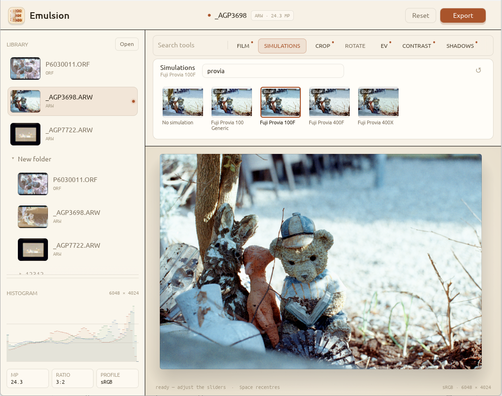

> **99.9% AI GENERATED**


---
Emulsion is a desktop photo editor that converts negative film scans into positive images.
Simple UI, precise color, with a bundled strip of film simulations.
Windows, Mac and Linux.

[Latest release](https://github.com/malltshik-inc/emulsion/releases/latest)

> **UNSIGNED**  
> Both Mac and Windows builds are not signed, so you might see security or might not be able to run app. 

> Workaround for Mac:
> - Copy app from .dmg to your Applications
> - Run command in terminal 
> ```bash
> xattr -r -d com.apple.quarantine /Applications/Emulsion.app
> ```
> - Open the app as you usually do. The error should be gone. 

---
Build from source: 
```bash
cargo build --release -p emulsion-app
```

Product spec: [docs/PRODUCT.md](docs/PRODUCT.md)  
Architecture: [docs/ARCH.md](docs/ARCH.md)  
